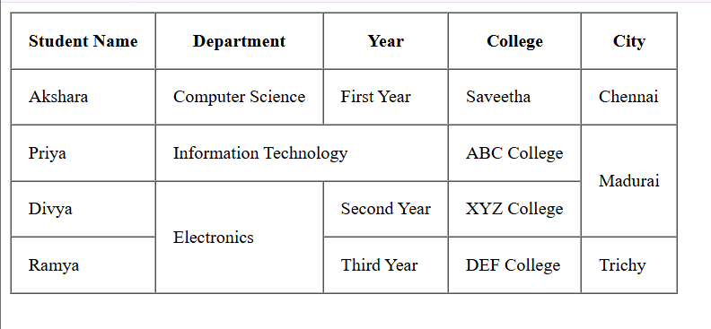

## HTML
```

<!DOCTYPE html>
<html>
<head>
    <title>HTML Table</title>
</head>
<body>

<table border="1" cellpadding="15" cellspacing="0">
    <tr>
        <th>Student Name</th>
        <th>Department</th>
        <th>Year</th>
        <th>College</th>
        <th>City</th>
    </tr>

    <tr>
        <td>Akshara</td>
        <td>Computer Science</td>
        <td>First Year</td>
        <td>Saveetha</td>
        <td>Chennai</td>
    </tr>

    <tr>
        <td>Priya</td>
        <td colspan="2">Information Technology</td>
        <td>ABC College</td>
        <td rowspan="2">Madurai</td>
    </tr>

    <tr>
        <td>Divya</td>
        <td rowspan="2">Electronics</td>
        <td>Second Year</td>
        <td>XYZ College</td>
    </tr>

    <tr>
        <td>Ramya</td>
        <td>Third Year</td>
        <td>DEF College</td>
        <td>Trichy</td>
    </tr>

</table>

</body>
</html>
```
## OUTPUT 
